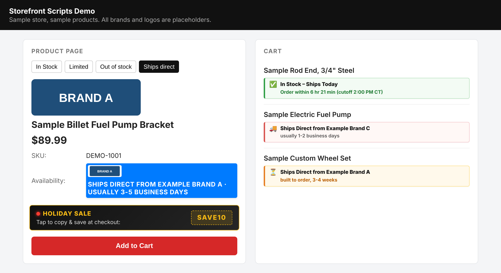
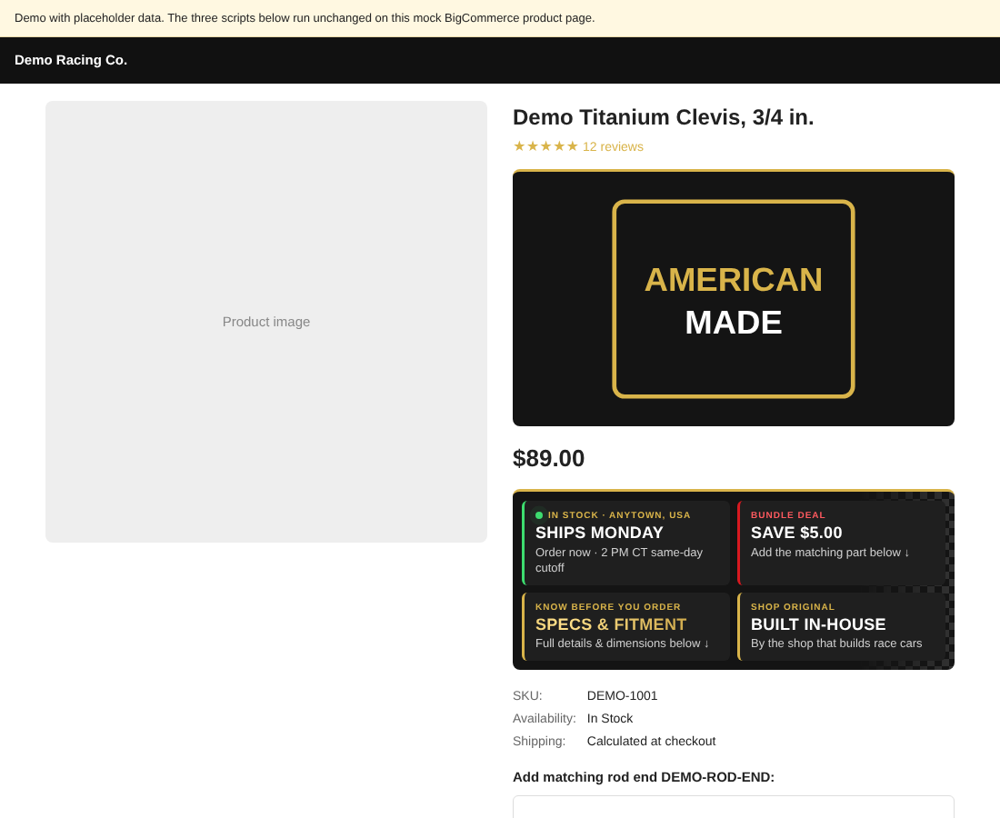

# BigCommerce Storefront Scripts

Three drop-in scripts I wrote for a BigCommerce store that sells race car parts. They tell customers when an item will actually ship, show brand logos in place of plain brand names, and let customers copy a promo code with one tap.

*Screenshot from the included demo page. All brands, products and logos are placeholders.*

   **[Try the live demo →](https://kyle-kelley-sr.github.io/bigcommerce-storefront-scripts/)**

## The problems

- **Customers didn't know when orders would arrive.** The store sells parts from its own shelves, parts that ship directly from the manufacturer, and parts that are built to order. Before checkout, all three looked the same.
- **Plain-text brand names looked unfinished** next to the product photos.
- **Promo codes got mistyped or forgotten** at checkout during sales.

## The scripts

| Script | What it does |
| --- | --- |
| [`cart-checkout-shipping-badges.js`](cart-checkout-shipping-badges.js) | Adds a badge under every cart and checkout item: **In Stock – Ships Today** with a live countdown to the same-day cutoff, **Ships Direct from &lt;Brand&gt;** with the expected timing, or **Built to Order** with the lead time. Uses the shop's time zone, skips weekends and holidays, and refreshes every 20 seconds. |
| [`product-page-brand-logos-and-stock-badges.js`](product-page-brand-logos-and-stock-badges.js) | Replaces the brand name with the brand's logo and turns the Availability text into a colored badge (In Stock, Limited Stock, Out of Stock, Ships Direct). Limited stock hides the exact count. |
| [`promo-code-banner.js`](promo-code-banner.js) | Animated promo banner above Add to Cart and at checkout. One tap copies the code; at checkout it also opens the coupon field and fills it in. |

## How the shipping badges work

1. Read the cart from BigCommerce's Storefront Cart API (`/api/storefront/carts`).
2. Fetch each item's product page in the background and read its **Availability** text, so the store manages everything from the normal product editor.
3. Classify each item: `in stock`, `ships direct`, or `built to order` (or a lead time in weeks).
4. For in-stock items, work out the shop's local time with `Intl.DateTimeFormat`. Show the time left before the cutoff, or the next ship day after weekends and closed dates.
5. Watch the page with a `MutationObserver`, because BigCommerce's checkout re-renders as the customer moves through it.

## Setup

1. In BigCommerce go to **Storefront → Script Manager → Create a Script**.
2. Location **Footer**. Pages: **Store pages** (add **Checkout** for the shipping badges and promo banner). Category **Essential**. Type **Script**.
3. Paste the file's contents between ``.
4. Edit the settings block at the top of each file: promo code, brand logo URLs, cutoff hour, time zone, closed dates.
5. Set each product's **Availability** text in the product editor, for example `In Stock`, `Ships Direct - usually 3-5 business days`, or `Ships Direct - built to order, 3-4 weeks`.

Tested on a Stencil theme with BigCommerce's Optimized One-Page Checkout. Other themes may use different class names for the product title and availability fields; adjust the selectors near the top of each function.

## Try the demo

Open [`index.html`](index.html) through any local web server (for example `python3 -m http.server`, then visit `http://localhost:8000/`). The demo mocks the cart API and product pages so the scripts run without a store.

## More scripts: product page promise strip

Three more scripts that answer the questions shoppers usually call about, right on the product page.

**[Try the product page demo →](https://kyle-kelley-sr.github.io/bigcommerce-storefront-scripts/product-page-demo.html)**

| Script | What it does |
| --- | --- |
| [`promise-strip.js`](promise-strip.js) | Row of tiles by the price: **Ships Today** with a live countdown to the 2 PM Central cutoff (skips weekends and holidays), or **Ships Direct** for dropship items; **Specs & Fitment** opens the description and scrolls to it; **Built In-House** on the shop's own SKUs; **Bundle Deal** on listed products. |
| [`bundle-deal-options.js`](bundle-deal-options.js) | Highlights add-on options that carry a bundle discount: pulsing outline, "Save $X" ribbon, was/now price, and a green "savings applied" state once picked. The promise strip reads the saving from it, so the price is set in one place. |
| [`made-in-usa-badge.js`](made-in-usa-badge.js) | Puts an "American Made" badge in the theme's banner slot on listed products only. Matches by URL first so it appears without flicker, then by product ID or SKU. |

Tiles work from the keyboard, and animations stop for shoppers who turn on reduced motion. Setup is the same as above: Script Manager, Footer, Store pages, then edit the settings block at the top of each file. The real bundle discount is set in BigCommerce (an option price adjustment or a cart rule); the script only displays it.

## Built with

JavaScript (no libraries), BigCommerce Script Manager and the Storefront Cart API. Built with AI assistance: I defined the requirements and edge cases, tested on the live store, and maintain the scripts.

## License

MIT
